<div align="center">

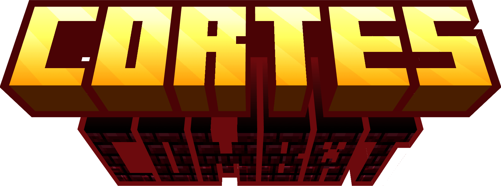

# Cortés Combat

**A combat rework for Minecraft 1.21.1 that explains itself.**

Every weapon carries a reach, an arc, a cooldown and a charge. The numbers are on the tooltip, the
server decides what a hit does, and the whole thing reads like something you can learn in a fight.

[Read in Spanish](README.es.md)

</div>

<div align="center">


</div>

---

Cortes Combat replaces the whole attack flow of Minecraft 1.21.1 and gives every weapon an
identity you can learn in a fight. A sword reaches further and hits a wide arc. The rapier reaches
the same distance through a needle of a cone, and dashes on the right click. The halberd stands
off and sweeps everything in front of it. The sabre is short, fast, and parries.

There is a fifth thing nobody expects. The Arcabuz is a gunpowder musket with a lit fuse, a
devastating short blast and a reload, and it has no business in a sword fight.

<p align="center">
  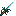
  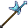
  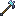
  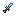
  
  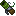
</p>

---

## See it work

These are the four mechanics everything else hangs off.

| | |
|---|---|
| 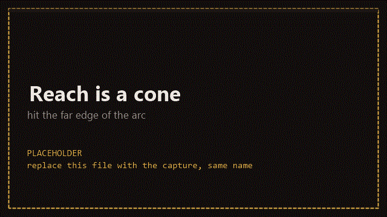 | **Reach is a cone.** Distance, a horizontal arc and a vertical arc. A swing only lands inside them, so a mob at the edge of the arc is a miss you can see coming. |
| 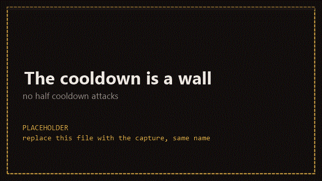 | **The cooldown is a wall.** Halfway through a cooldown you cannot attack, and there is no damage bonus for timing a swing well. The rhythm belongs to the weapon. |
| 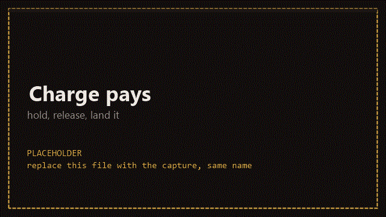 | **Charge pays.** Hold the attack to load a bonus, release to land it. A charged hit always loses on damage per second against fast tapping, and it always wins when you need one big hit. |
| 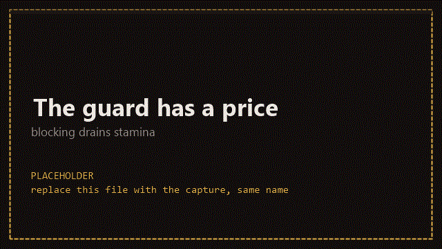 | **The guard has a price.** Blocking spends stamina, three hits and you are open. Holding the guard up costs nothing, only taking a hit on it does. |

---

## What changes

### Every weapon has numbers, and the tooltip shows them

Seven lines replace the two vanilla ones. Damage, charged damage, attacks per second, reach, arc
size, knockback and the right click ability, plus how many targets a swing can reach.

| Weapon | Reach | Arc (horizontal / vertical) | Charge | Right click |
|---|---|---|---|---|
| Bare hands | 2.5 | 28° / 22° | +30% over 12 ticks | — |
| Sword | 3.6 | 35° / 30° | +50% over 25 ticks | — |
| Axe | 3.4 | 35° / 25° | +200% over 60 ticks | — |
| Shovel | 3.0 | 35° / 30° | +40% over 33 ticks | — |
| Hoe | 3.2 | 60° / 50° | — | Cleave |
| Trident | 5.3 | 15° / 25° | +50% over 25 ticks | — |
| Ropera (rapier) | 3.6 | 13° / 16° | — | Lunge |
| Dagger | 2.9 | 49° / 31° | — | — |
| Alabarda (halberd) | 5.0 | 60° / 35° | +60% over 36 ticks | Sweep |
| War hammer | 3.4 | 36° / 36° | +60% over 32 ticks | — |
| Shotel (sabre) | 2.25 | 75° / 25° | +100% over 20 ticks, lands two cuts | Parry |
| Arcabuz | 2.6 bayonet, 6.5 shot | 46° / 35° | — | Light the fuse |

The pickaxe stays a tool on purpose. The numbers above are the defaults, and any of them can be
replaced per item, per mod or per pack.

<p align="center">
  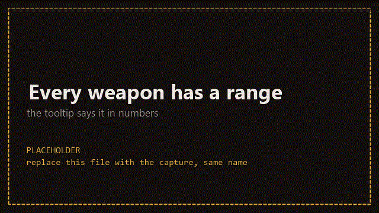
</p>

### Five new melee families, none of them a reskinned sword

<p align="center">
  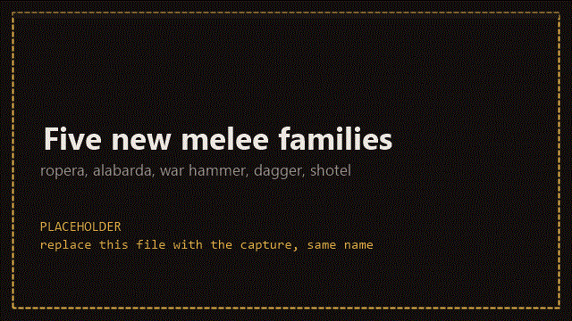
</p>

The **ropera** is a needle. Thirteen degrees of cone means you have to mean it, and the right
click dashes you through a line of mobs. The **alabarda** stands off at five blocks and sweeps
everything in a sixty degree arc, and it pays four times the cooldown for the privilege. The
**war hammer** lifts what it hits, grows its damage with every consecutive swing, and ignores
armour when charged. The **dagger** is the fastest thing that can still hurt you, and it never
charges. The **shotel** is a Muslim sabre with a curved blade, it parries for a fraction of a
second, and a full charge lands two separate cuts.

All of them come in several tiers, from wood or stone up to netherite, and the copper set has its
own textures.

### The Arcabuz

<p align="center">
  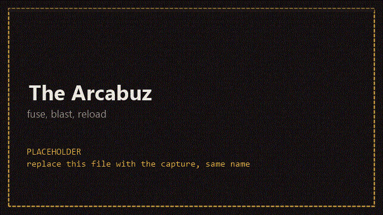
</p>

A gunpowder musket. The right click lights the fuse and you watch it burn down, the left click
puts a bayonet through anything close and fires a blast at six and a half blocks. It reloads, it
shakes the camera when it goes off, and it is very bad for a sword fight.

### Right click is another weapon

<p align="center">
  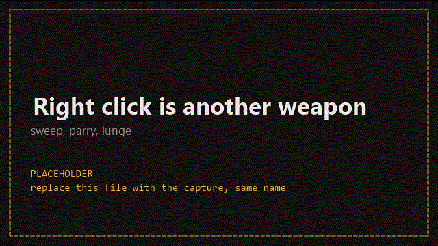
</p>

Three of the new families answer the right click, and each one answers it differently. The lunge
moves you and hits a cube in front of you. The sweep clears an arc and costs four cooldowns. The
parry cancels one incoming hit, returns it, and then goes on cooldown for five seconds.

### Hunger is a healing resource

<p align="center">
  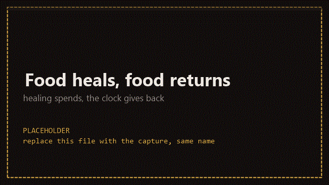
</p>

Running, mining and swinging cost nothing. Food is only ever spent to heal, and it comes back on
its own clock, so the loop closes. A hit interrupts your meal unless your guard is up, and you can
cover and eat with one button, in that order.

### 48 enchantments, and six vanilla ones reworked

<p align="center">
  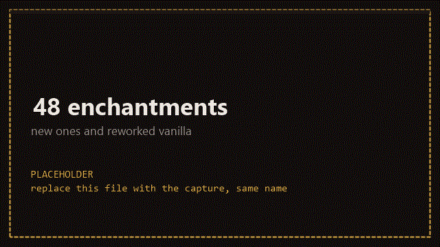
</p>

Forty eight of them are new, and Sharpness, Smite, Looting, Knockback, Fire Aspect and Bane of
Arthropods were reworked into the same system. They range from a spectral sword to flying pigs
that are not really flying pigs, and each one hangs off a real rule in the combat system. None of
them is a number nobody reads.

### The Nether Reactor

<p align="center">
  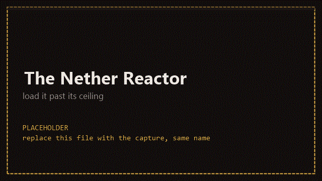
</p>

Load the reactor, push it past its ceiling, and it becomes the heart of your base. Push it further
and it detonates, and it takes the terrain with it.

### Feedback you can read without looking

<p align="center">
  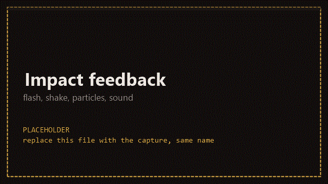
</p>

A red flash and a life bar that drains as the mob bleeds out, the body turning white as it dies,
camera shake scaled to what hit you, blood that falls, a slash wave that grows with the weapon
that made it, and a directional indicator for damage that comes from behind you.

### The body moves in third person

<p align="center">
  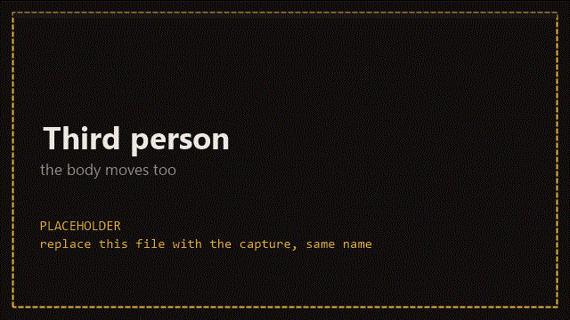
</p>

The wind up, the charge and the swing exist in the world, and the camera is only one of the places
where they show up. Other players see them too.

### Your own weapons, without writing code

<p align="center">
  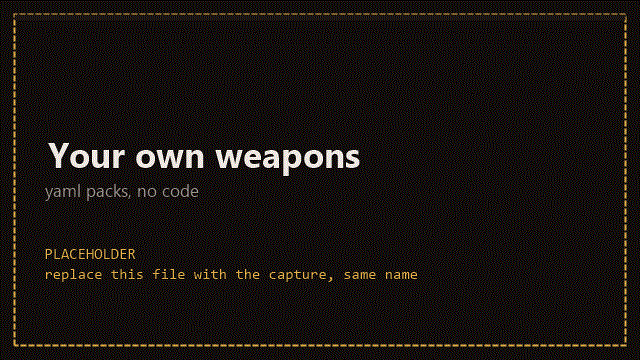
</p>

A YAML file in `config/cortescombat/weapons/` can describe a weapon by its item id, or invent one
that does not exist yet and hand it the stats you like. A datapack tag can point at a weapon and
say "treat this like a halberd". Both reload at runtime, and `/cc packs` tells you which file is
claiming the item in your hand.

The full field reference, the nine archetypes and a troubleshooting list live in
[`docs/armas-custom.md`](docs/armas-custom.md).

---

## Compared to the alternatives

**Vanilla.** Vanilla has one reach, one arc, one cooldown and a crit that rewards mashing at the
right moment. Cortes Combat gives every weapon its own numbers, and the timing becomes a decision
where vanilla asks for a reflex. If you want the vanilla feel, the `combatRework` toggle in the
server config turns the whole thing off.

**Combatify.** The combat mod this project was measured against, and the one with the biggest
rewrite of its own. It is a Fabric mod, it touches far more of the game, and it expects a reading
of its documentation before you play. Cortes Combat keeps the scope on melee, explains every
number on the tooltip, and ships on NeoForge.

**Other combat mods.** Cortes Combat refuses to load next to a competing combat mod and says
which one it found. Two mods rewriting the same attack flow desyncs the game, and nothing good
comes out of that.

**When to skip it.** Skip it if you want realistic survival combat, if your server already runs
another combat overhaul, if you play on Fabric, or if you like the vanilla attack rhythm and only
wanted a reskin. The pickup axe, the shovel and the sword already carry their own identities in
vanilla and this mod throws those away on purpose.

---

## Install

Requirements are Minecraft **1.21.1**, NeoForge **21.1.250** or newer, and **Java 21**.

Drop the jar in `mods/`. On a server the jar goes on the server and on every client that connects
to it, because the client draws the animations and the server decides the hits.

There is no jar to download yet. Build it from source:

```bash
git clone https://github.com/CerebroCanibalus/cortes-combat.git
cd cortes-combat
./gradlew build          # Windows: gradlew.bat build
```

The jar lands in `build/libs/`. For a development environment, `./gradlew runClient` and
`./gradlew runServer` boot the game with the mod already loaded.

---

## FAQ

**Does the mod need to be on every client?**
Yes. The server decides the hits and the client draws the arcs, the charges and the animations.

**Does it work on a server with other players?**
Yes, and the body animations are synced, so other players see your wind up and your charge.

**Can I turn parts of it off?**
Yes. The server config has `combatRework`, `survivalRework` and `particles`. The first one
reverts the whole attack flow to vanilla, the second reverts hunger, the third turns off the
particles and leaves the sound alone.

**Does it change vanilla weapons?**
Yes. The sword, the axe, the hoe, the shovel, the mace and the trident join the system with new
numbers. The pickaxe stays a tool.

**How do I get the Arcabuz?**
Craft it. Bamboo, planks, a dispenser and a flint and steel. The firestone it loads is gunpowder
and glowstone dust.

**Why does my weapon from another mod hit like a punch?**
Nothing has claimed it, so it fell back to a bare handed profile. Write a pack entry or a tag for
it, see [`docs/armas-custom.md`](docs/armas-custom.md).

**Can I have a real multiplayer session with it?**
Yes, and the animation sync is the part that needs two people to check.

---

## Settings

Client settings and world settings live in the standard NeoForge config locations. A server admin
tunes the balance centrally and every player keeps their own visual preferences.

The numbers that decide how the mod feels are in the server config, and the two that matter most
are `foodRegenInterval` and `healFoodCost`. Too fast and food is decoration, too slow and a fight
is a dead end.

Operators get a `/cc` command. `/cc stats` prints the profile, reach, cooldown, charge and
special of the weapon in your hand, `/cc packs` lists the loaded weapon packs and which one
claims the current item, `/cc reload` re-reads the pack files without restarting the server, and
`/cc input` prints every gate that can reject a click, in order, with the value it reads.

---

## When something breaks

**The mod does not appear in the mod list.** Wrong loader or wrong Minecraft version. It is
NeoForge on 1.21.1 and nothing else.

**`Unsupported class file major version` on startup.** Java is too old. It needs Java 21.

**The game refuses to load and names another mod.** You have a combat mod it cannot coexist with.
Remove one of the two.

**A weapon from another mod hits like a punch.** Nothing claims it, so it fell back to a bare
handed profile. Write a pack entry or a tag for it.

**Hits that should land miss.** You are outside the cone. `/cc stats` prints the arcs of the
weapon you are holding.

**Your weapon pack did nothing.** Check `/cc packs`. The item id has to match exactly, and a
resource pack that failed to load takes the whole file with it.

**The animations look wrong after a mod update.** The client keeps the classes it loaded at
startup. Restart it.

---

## How it works

The server owns every number. When you swing, the client sends what you aimed at and how long
you held the button, and the server decides whether the swing lands, how much it does and what it
pushes. The client only draws. A desynced client shows a wrong animation for a moment, and it
cannot change the fight.

The numbers live in data, and the code reads them. Each item carries a profile that says which
weapon it is, and each weapon has a table of reach, charge, knockback and ability. A pack, a tag
or a datapack can replace any of it for any item, which is why a weapon from another mod can have
a full identity without anyone writing a line of Java.

The animations are per weapon and driven by a small set of named channels. A weapon declares
which channels it reads, and one solver turns the player's state into a pose. The same solver
runs for your own body in third person and for the body of a player you are looking at, so both
read the same numbers.

The enemy balance is untouched. A zombie hits for what a zombie hits for. What changes is the
conversation you have with it.

---

## Contributing · Security · License

- Bug reports and feature requests use the [issue templates](.github/ISSUE_TEMPLATE). The bug form
  asks for a log, and without one there is very little to go on.
- Read [CONTRIBUTING.md](.github/CONTRIBUTING.md) before opening a pull request.
- Found a security problem? See [SECURITY.md](.github/SECURITY.md), and please do not open a public
  issue for it.
- Licensed under the **GNU General Public License v3.0 only**. See [LICENSE](LICENSE).

---

*"La técnica es una actividad compositora o destructora, violenta, y esto es lo que Aristóteles llamaba la poiesis, la poesía, precisamente."*

```
                                                  █   █
                                                       █
                                                              █           █
                                                          █  █  █  █
                                                ████████████    ███  ██
                                                █ █████████████████   █     █
                                        █   █████████████████████████████
                                         ███ ███████████████████████        █
                                            █████ ███████████████████ █ █    ██   █
                                           ███████████████████████████ █       █
                                          ██████████████████████████████     █ █
                                         ██████████ ██████████████████         █
                                       ██████████ ████████████████████
                                       ████████████████████████████████   █    █ █
                                         ███████████████████████████████
                                     ████    ███ ████  █          ██████   █  █  █
                            █               █ ██    █   ██████  █████████     █
                          █      ██████████  ███████   █      ████   ███     █
                         █     █             █                        ██ █       ██████
                                                ██   █    █ ██████   █ ██  █ █  █ █    █
                                               ███          █  ███████     ███████ █   █
                              █       ███     █████  █    █ ██ ████████ ████  █ █████  █
                          █      ████ ███    ███████ █████   ██ ████████  █████  ████ █
                           █     ██ ████     ███████  █ ████████████████████ ██ █ ██ █
                             █████     █     █████████████████████████████ █ █    █ █
                           ██               █████████  ██████████████████    █████ █
                        ██        ██████   ████████████ ███████████████████ █████ █
                   █  █████       █████ ████████████████████████████████    ██████
                  █ ██████          ██      ██████   ███ ███████████████  ██ ████
                 █ ██████      █████          █ ████████████████████████  █
                  ██████ ██████████████      ███████████████████████████ ██
                 ██████  ████████████████        ██████████████████████  █
              █   ██████  ███████         █████████████████████████████  █
                   ███     ██████                         ████████████ █ █
                    ██  █   █████            █████████████ ██████████ █ ██
                     ██     ███████         ██████████████████████████  █
                       █     ███████         ███████████████████████   ██
                             █████████         ████████████████████  █ ██
                           ██████████████         ███████████████████ ██
                              ██████████████████████████████████  ██ ███
                                █  ███████████ █████████████    █ █ ███
                                    ████████████ █████████    ███  ████
                                 █   ████████████ █████████ ███   ████
                                  █   ████████████   ██ █   █   █████
                                      ██████████████      █   ███████
                                       ██████████████ ██    ████████
                                    █  ██████████████   ████████████
                                         ████████████████     ██████
                                         ████████████████        ███
                                          █████████████████      ██
                                           ████████████████ █  ████
                                              ███████████████  ████
                                                  █████████████  █
                                                       ████████
                                                       ████████
                                                      █████████
                                                     █████████
                                                     ████████
                                                    ███████
                                                    ██████
                                                    ████    —Gustavo Buenoφ
```

<div align="center">
☭ Por los obreros iberófonos del mundo ☭

† 🇪🇸 🇲🇽 🇦🇷 🇨🇴 🇨🇱 🇵🇪 🇻🇪 🇪🇨 🇬🇹 🇨🇺 🇧🇴 🇩🇴 🇭🇳 🇵🇾 🇸🇻 🇳🇮 🇨🇷 🇵🇦 🇺🇾 🇪🇶 🇵🇷 🇬🇶 🇵🇹 🇧🇷 🇲🇿 🇦🇴 🇨🇻 🇲🇴 🇬🇼 🇸🇹 🇹🇱 †

</div>


