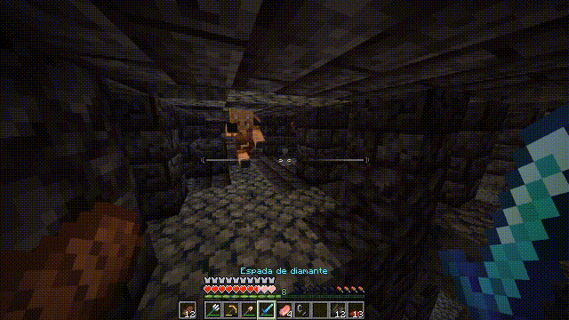
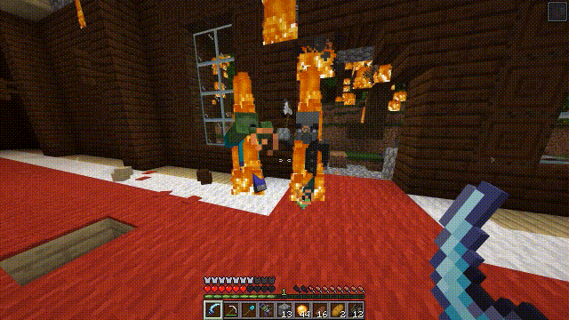
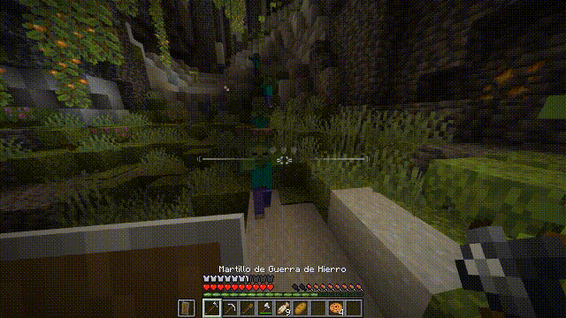
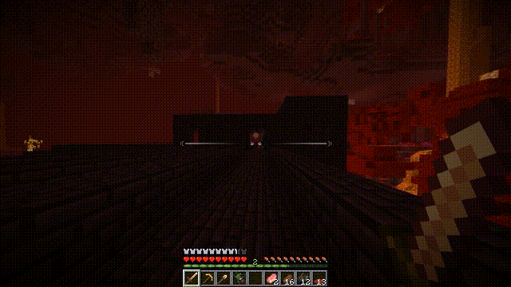
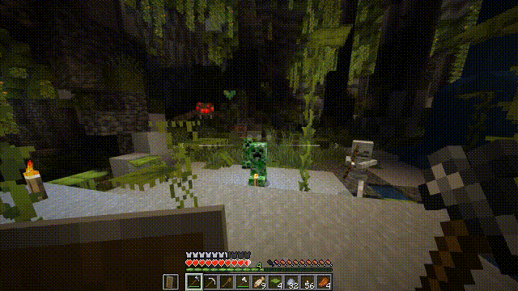
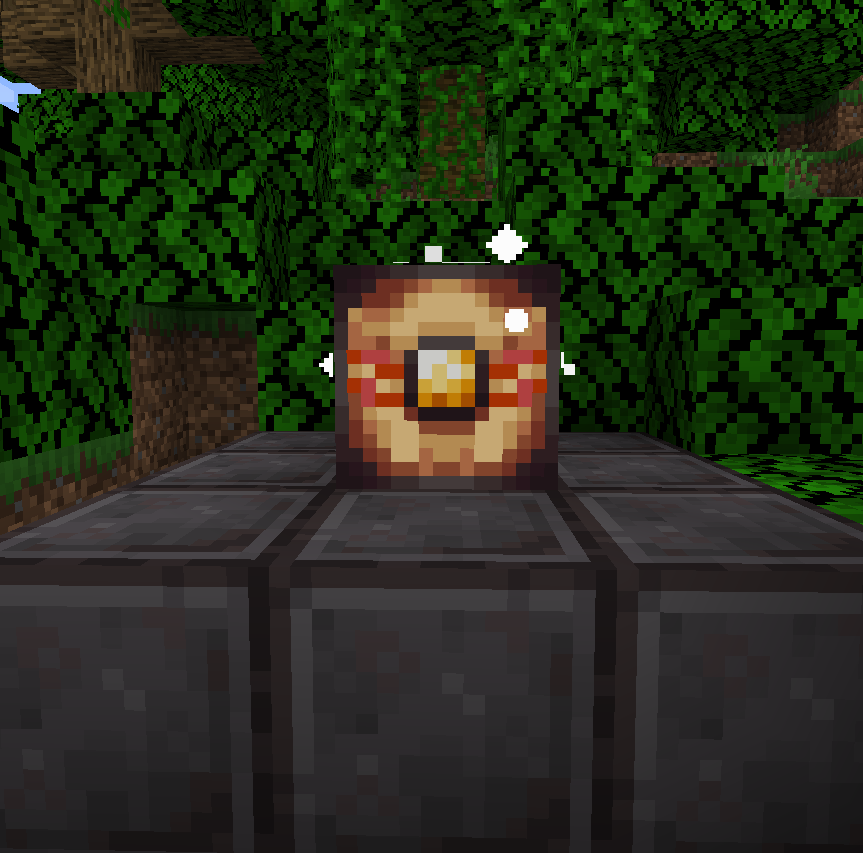

<div align="center">


# Cortés Combat

**A combat rework for Minecraft 1.21.1 that explains itself.**

Every weapon carries a reach, an arc, a cooldown and a charge. The numbers are on the tooltip, the
server decides what a hit does, and the whole thing reads like something you can learn in a fight.

[Read in Spanish](README.es.md)

</div>

<div align="center">


</div>

---

Cortes Combat replaces the whole attack flow of Minecraft post 1.9 combat update and gives every weapon an identity you can learn in a fight. 

There is a fifth thing nobody expects. The Arcabuz is a gunpowder musket with a lit fuse, a devastating short blast and a reload, and it has no business in a sword fight.



---

## See it work

These are the four mechanics everything else hangs off.

| | |
|---|---|
|  | **Reach is a cone.** It has been turned into a horizontal arc and a vertical arc. A swing only lands inside them, so pixel perfect hits are not an annoyance anymore. |
|  | **Beware the cooldown.** Halfway through a cooldown you cannot attack, and there is no damage bonus for timing a swing. The rhythm belongs to the weapon type. |
|  | **Charge!!!** Hold the attack to deal a devastating slash. Big risk, big reward. |
|  | **The guard has a price.** Blocking spends stamina, three hits and you are open. Holding the guard up costs nothing, only taking a hit on it does. |

---

### Five new melee families join the game none of them a reskinned sword


The **ropera** is a needle. Thirteen degrees of cone means you have to mean it, and the right click dashes you through a line of mobs, dealing bonus damage per mob penetrated. 

The **alabarda** stands off at five blocks and sweeps everything in a sixty degree arc, and it pays four times the cooldown for the privilege. 

The **war hammer** lifts what it hits, grows its damage with every consecutive swing, and ignores armour when charged. 

The **dagger** is the fastest thing that can still hurt you, but it can't charge. :(

The **shotel** is a Muslim sabre with a curved blade (Needed to mention it), it parries for a fraction of a second, and a full charge lands two separate cuts.

### The Arcabuz

A gunpowder primitive musket. Load and right click to light the fuse, firing a blast at six and a half blocks to multiple enemies and burning them to ashes. 

You know what they say, never bring a gun to a sword fight... Wait, that's not quite right.

### Hunger is reworked

Running, mining and swinging cost nothing now. Food is only ever spent to heal, and it regenerates very slowly. You can gain it back quickly by eating, BUT if you get hit it interrupts your meal, however you can guard and eating at the same time.

### 40+ enchantments, and 6 vanilla reworks

With the introduction of more fulfilling weapons with specific roles, a repurpose of enchantments was needed, along with an expansion for both new and olds ones. They range from a spectral sword, to electrical shocks and flying pigs that are not really flying pigs (I knew it!).

### The Nether Reactor



Feed the reactor and it will become the heart of your base. The more you charge, the bigger the range, destroying the corrupted souls that wander your home and providing extended energy range for your redstone mechanisms. 

But be careful of feeding it a bit too much...

### Your own weapons, without writing code!

You can add your own weapons and compatibility with other mods through a YAML file in `config/cortescombat/weapons/`, describe a weapon by its item id, or invent one that does not exist yet and hand it the stats you like. A datapack tag can point at a weapon and say "treat this like a halberd". It is able to hotreload stat changes and load custom sprites and sounds through a resourcepack.

The first time the mod runs it drops an annotated example at `config/cortescombat/weapons/`, with every field commented in Spanish and English. A guide is also dropped at `config/cortescombat/weapons/GUIA_WEAPON_PACKS.md`.

The first time the mod runs it writes `config/cortescombat/weapons/cortescombat_weapons.yaml` with all of the mod's own weapons, so you can edit their stats directly. Run `/cc export weapons` to generate a timestamped copy instead (useful for backups). Either way, edit the file and reload with `/cc reload`.

Check the guide in:
[`docs/custom-weapons.md`](docs/custom-weapons.md), or in Spanish in
[`docs/custom-weapons.es.md`](docs/custom-weapons.es.md).

---

## Install

Requirements are Minecraft **1.21.1**, NeoForge **21.1.250** or newer, and **Java 21**.

Drop the jar in `mods/`. On a server the jar goes on the server and on every client that connects
to it, because the client draws the animations and the server decides the hits.

**Download:** [Cortés Combat 1.4.12 for Minecraft 1.21.1](https://github.com/CerebroCanibalus/cortes-combat/releases/tag/v1.4.12)
(`Cortes-combat-1.4.12-1.21.1.jar`).

Or build it from source:

```bash
git clone https://github.com/CerebroCanibalus/cortes-combat.git
cd cortes-combat
./gradlew build          # Windows: gradlew.bat build
```

The jar lands in `build/libs/`. For a development environment, `./gradlew runClient` and
`./gradlew runServer` boot the game with the mod already loaded.

---

## FAQ

**Does the mod need to be on every client?**
Yes. The server decides the hits and the client draws the arcs, the charges and the animations.

**Can I turn X system off?**
Yes you can comrade. Almost everything the mod adds is configurable.

**Why does my weapon from another mod hits like a punch?**
Nothing has claimed it, so it fell back to a bare handed profile. Write a pack entry or a tag for
it, see [`docs/custom-weapons.md`](docs/custom-weapons.md).

**How do I edit the mod's own weapons?**
Run `/cc export weapons` in-game. It dumps every weapon to a timestamped YAML in
`config/cortescombat/weapons/`. Edit the file, then run `/cc reload` to apply.

**Is it multiplayer compatible?**
Yes and fully tested!

---

## Contributing · Security · License

- Bug reports and feature requests use the [issue templates](.github/ISSUE_TEMPLATE). The bug form
  asks for a log, and without one there is very little to go on.
- Read [CONTRIBUTING.md](.github/CONTRIBUTING.md) before opening a pull request.
- Found a security problem? See [SECURITY.md](.github/SECURITY.md), and please do not open a public
  issue for it.
- Licensed under the **GNU General Public License v3.0 only**. See [LICENSE](LICENSE).

---

*"La técnica es una actividad compositora o destructora, violenta, y esto es lo que Aristóteles llamaba la poiesis, la poesía, precisamente."*

```
                                                  █   █
                                                       █
                                                              █           █
                                                          █  █  █  █
                                                ████████████    ███  ██
                                                █ █████████████████   █     █
                                        █   █████████████████████████████
                                         ███ ███████████████████████        █
                                            █████ ███████████████████ █ █    ██   █
                                           ███████████████████████████ █       █
                                          ██████████████████████████████     █ █
                                         ██████████ ██████████████████         █
                                       ██████████ ████████████████████
                                       ████████████████████████████████   █    █ █
                                         ███████████████████████████████
                                     ████    ███ ████  █          ██████   █  █  █
                            █               █ ██    █   ██████  █████████     █
                          █      ██████████  ███████   █      ████   ███     █
                         █     █             █                        ██ █       ██████
                                                ██   █    █ ██████   █ ██  █ █  █ █    █
                                               ███          █  ███████     ███████ █   █
                              █       ███     █████  █    █ ██ ████████ ████  █ █████  █
                          █      ████ ███    ███████ █████   ██ ████████  █████  ████ █
                           █     ██ ████     ███████  █ ████████████████████ ██ █ ██ █
                             █████     █     █████████████████████████████ █ █    █ █
                           ██               █████████  ██████████████████    █████ █
                        ██        ██████   ████████████ ███████████████████ █████ █
                   █  █████       █████ ████████████████████████████████    ██████
                  █ ██████          ██      ██████   ███ ███████████████  ██ ████
                 █ ██████      █████          █ ████████████████████████  █
                  ██████ ██████████████      ███████████████████████████ ██
                 ██████  ████████████████        ██████████████████████  █
              █   ██████  ███████         █████████████████████████████  █
                   ███     ██████                         ████████████ █ █
                    ██  █   █████            █████████████ ██████████ █ ██
                     ██     ███████         ██████████████████████████  █
                       █     ███████         ███████████████████████   ██
                             █████████         ████████████████████  █ ██
                           ██████████████         ███████████████████ ██
                              ██████████████████████████████████  ██ ███
                                █  ███████████ █████████████    █ █ ███
                                    ████████████ █████████    ███  ████
                                 █   ████████████ █████████ ███   ████
                                  █   ████████████   ██ █   █   █████
                                      ██████████████      █   ███████
                                       ██████████████ ██    ████████
                                    █  ██████████████   ████████████
                                         ████████████████     ██████
                                         ████████████████        ███
                                          █████████████████      ██
                                           ████████████████ █  ████
                                              ███████████████  ████
                                                  █████████████  █
                                                       ████████
                                                       ████████
                                                      █████████
                                                     █████████
                                                     ████████
                                                    ███████
                                                    ██████
                                                    ████    —Gustavo Buenoφ
```

<div align="center">
☭ Por los obreros iberófonos del mundo ☭

† 🇪🇸 🇲🇽 🇦🇷 🇨🇴 🇨🇱 🇵🇪 🇻🇪 🇪🇨 🇬🇹 🇨🇺 🇧🇴 🇩🇴 🇭🇳 🇵🇾 🇸🇻 🇳🇮 🇨🇷 🇵🇦 🇺🇾 🇪🇶 🇵🇷 🇬🇶 🇵🇹 🇧🇷 🇲🇿 🇦🇴 🇨🇻 🇲🇴 🇬🇼 🇸🇹 🇹🇱 †

</div>
